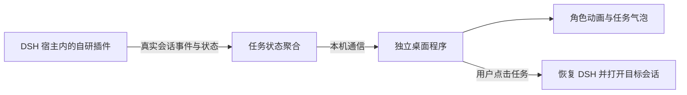

# 开发准备与实施顺序

日期：2026-10-23。本文记录技术方向和待验证事项，不表示功能已经实现。

## 架构方向

宿主插件负责收集全局状态，独立桌面程序负责窗口、角色和气泡；运行信息与角色文案分别管理，按任务状态决定是否显示。仅渲染在 DSH 内部的浮层无法满足最小化后的桌面显示需求。

用户已授权第一阶段开发。先验证最小链路，再建立功能脚手架；优先使用现有 Windows 环境和本机进程通信，落实技术栈后在本文记录选择依据。

## 已有接口线索

前期方案调研读取过本机 DSH 0.1.7-rc.2 相关包的类型与实现。版本升级后，实施前应再次对照实际接口。

| 位置 | 已查到的接口 | 计划用途 |
| --- | --- | --- |
| `@deepseek-ai/dsh-session` | `session/event`；事件内容含 `turn/start`、`turn/end`、`tool/call`、`tool/result` | 在宿主端观察真实执行生命周期；按事件类型处理，不能把每种内容类型当成同名总线事件 |
| `@deepseek-ai/dsh-api-session-controller` | 会话摘要中的 `running`、`parentId`、`origin`；列表状态及会话投影 | 获取全局任务集合与父子关系，包含未打开的会话；不得为观察任务额外启动或恢复执行 |
| `@deepseek-ai/dsh-client-ui-workspace` | `uiWorkspace.openSession(target)` | 客户端定位会话；从独立窗口唤起 DSH 的完整链路待验证 |
| `@deepseek-ai/dsh-client-ui-layout` | `shell.overlay` | DSH 应用内部浮层，不承担系统桌面窗口职责 |
| 审批与用户问题相关包 | 待审批、待输入状态 | 与普通运行、失败分别展示 |

`turn/end` 存在多种结束原因，不能将所有结束事件归为成功，也不能把工具层错误直接归为任务最终失败。重连时先同步当前快照，再接收增量，避免显示已结束任务或重复结束通知。

参考资料：

- [DSH 事件机制](https://deepseek-harness.github.io/deepseek-harness/develop/framework/events)
- [DSH 插件发布](https://deepseek-harness.github.io/deepseek-harness/develop/basic/publish)
- [DSH Desktop：关闭窗口与退出](https://github.com/deepseek-ai/deepseek-harness/blob/master/apps/desktop/README.md#closing-the-window-and-quitting)
- [Electron BrowserWindow](https://www.electronjs.org/docs/latest/api/browser-window)（候选窗口方案资料，不代表已选型）

## 后续实施顺序

| 阶段 | 交付内容 | 进入下一阶段的条件 |
| --- | --- | --- |
| 0：准备 | 仓库、需求、素材接入说明、验收清单 | 已提交并推送 |
| 1：最小链路验证 | 一个桌面窗口接收两个真实 DSH 会话的执行状态，点击后跳回正确会话 | 最小化/遮挡后仍更新，不抢焦点；确认宿主接口与桌面技术栈 |
| 2：任务与状态 | 全局任务集合、子任务聚合、运行/等待/结束/失败/停止语义 | 用真实事件验证，不误报成功/失败，不混入运行文案 |
| 3：角色表现 | 10 种形态、持续动画、状态文案、角色轮换 | 长时间工作不冻结；文案符合状态与角色 |
| 4：桌面交互 | 气泡折叠、拖动、多屏、缩放、设置保存、启动退出清理 | 完成桌面场景验收 |
| 5：交付 | 可安装插件与桌面配套程序、安装说明、版本与兼容范围 | 按验收清单记录实测结果 |

## 第一阶段要落实的决定

1. 如何从插件完整获得当前宿主实例的会话集合及持续事件，包括未打开的会话。
2. 桌面窗口采用哪种实现，如何保证后台动画、透明区域穿透与多屏坐标正确。
3. 本机进程之间采用何种通信，如何标识宿主实例、会话和执行轮次，避免不同实例串线。
4. 点击气泡时如何恢复 DSH 主窗口，再通过客户端导航定位会话。
5. 插件卸载/停用、宿主退出、桌面程序异常退出后如何清理并恢复连接。

上述事项在当前开发阶段核实。2026-10-23 17:50（Asia/Shanghai）停止新增功能，整理实际进度、启动方式与未完成项并推送，供用户回家继续。
